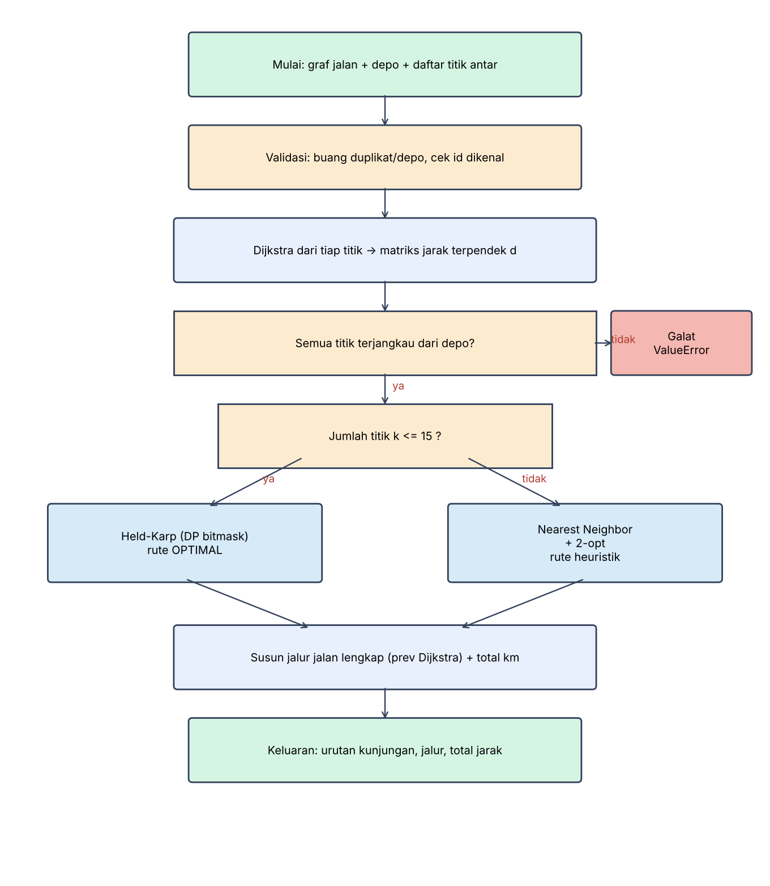
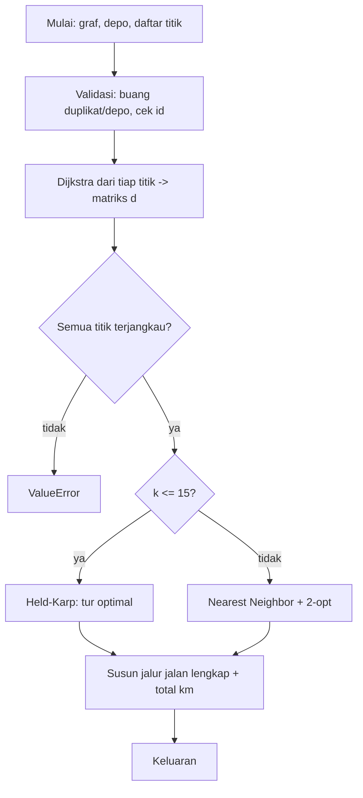

# D03 – Desain Solusi

## 1. Diagram alur



Versi Mermaid (dirender otomatis oleh GitHub):



## 2. Pseudocode

**Dijkstra(G, s)**
```
dist[v] <- inf untuk semua v; dist[s] <- 0; PQ <- {(0, s)}
selama PQ tidak kosong:
    (du, u) <- ambil minimum dari PQ
    jika du > dist[u]: lanjut            # entri usang
    untuk setiap (v, w) tetangga u:
        jika du + w < dist[v]:
            dist[v] <- du + w; prev[v] <- u; masukkan (dist[v], v) ke PQ
kembalikan dist, prev
```

**Held-Karp(d)**  — titik antar 1..m, depo 0
```
untuk j = 1..m: dp[{j}][j] <- d[0][j]
untuk S dalam urutan ukuran naik, untuk j dalam S, untuk k bukan dalam S:
    dp[S ∪ {k}][k] <- min(dp[S ∪ {k}][k], dp[S][j] + d[j][k])   # catat parent
biaya <- min_j ( dp[semua][j] + d[j][0] )
rekonstruksi tur dengan mengikuti parent mundur dari j terbaik
```

**NN + 2-opt(d)**
```
tur <- [0]; selama ada titik belum dikunjungi: tambahkan titik terdekat dari tur.akhir
ulangi sampai tidak ada perbaikan:
    untuk i = 1..n-2, j = i+1..n-1:
        delta <- d[a][c] + d[b][e] - d[a][b] - d[c][e]   # a=tur[i-1], b=tur[i], c=tur[j], e=tur[j+1]
        jika delta < -epsilon: balik segmen tur[i..j]
```

## 3. Contoh input–output

Perintah: `python -m rute.cli --scenario S1 --method held_karp`

| | |
|---|---|
| Input | Depo 0; titik antar `4;5;10;21;26;35` (Sunter, Cempaka Putih, Kebon Jeruk, Cawang, Kramat Jati, Ancol) |
| Output | Urutan kunjungan, total **72,823 km** (hasil eksekusi nyata, lihat `outputs/experiment_scenarios.csv`) |
| Pembanding | Urutan masukan = 87,293 km → penghematan 16,6% |

Contoh kecil yang bisa diverifikasi tangan ada di D06 (graf 4 simpul untuk Dijkstra, 4 titik untuk Held-Karp).

## 4. Rancangan evaluasi

| Aspek | Metode | Berkas |
|---|---|---|
| Kebenaran Dijkstra | Bandingkan semua pasangan dengan Floyd-Warshall pada 5 graf acak + contoh tangan | `tests/test_dijkstra.py` |
| Kebenaran Held-Karp | Bandingkan biaya dengan brute force (8 instans, 7 titik antar) + persegi 1×1 | `tests/test_tsp.py` |
| Validitas rute | Permutasi lengkap, mulai di depo, biaya Route = jumlah panjang ruas `road_path` | TC09, TC10, TC15 |
| Kualitas heuristik | Selisih (%) terhadap optimum Held-Karp, *k* = 5…15, 85 instans | `scripts/run_experiments.py` |
| Performa | Waktu vs ukuran input (Held-Karp, NN+2-opt, Dijkstra) | `outputs/experiment_scaling.csv` |
| Ketahanan | Kasus batas (0, 1, 2 titik; semua 41 lokasi) dan masukan tidak valid | TC12–TC20, TC23 |
| Baseline | Urutan masukan apa adanya (`--method input`) | Eksperimen A, C |
