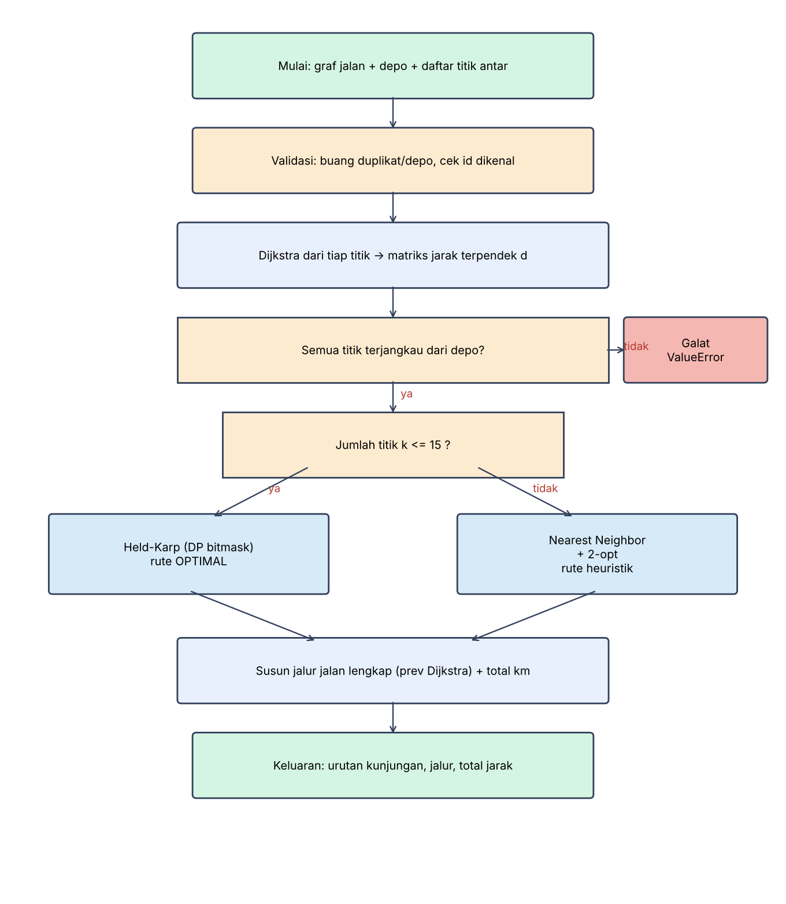
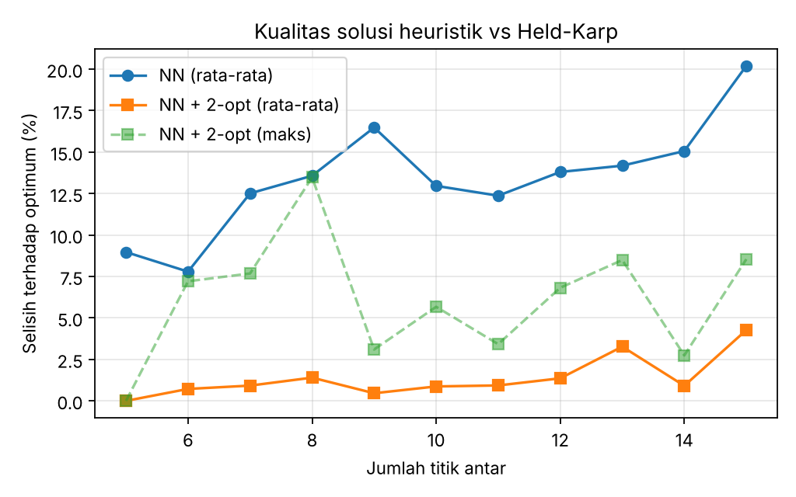
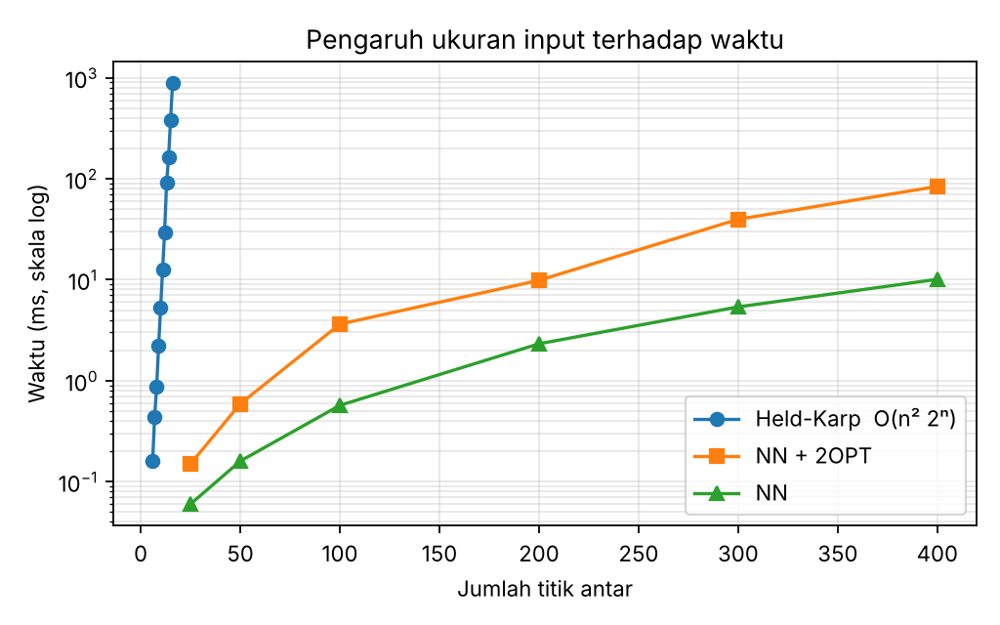
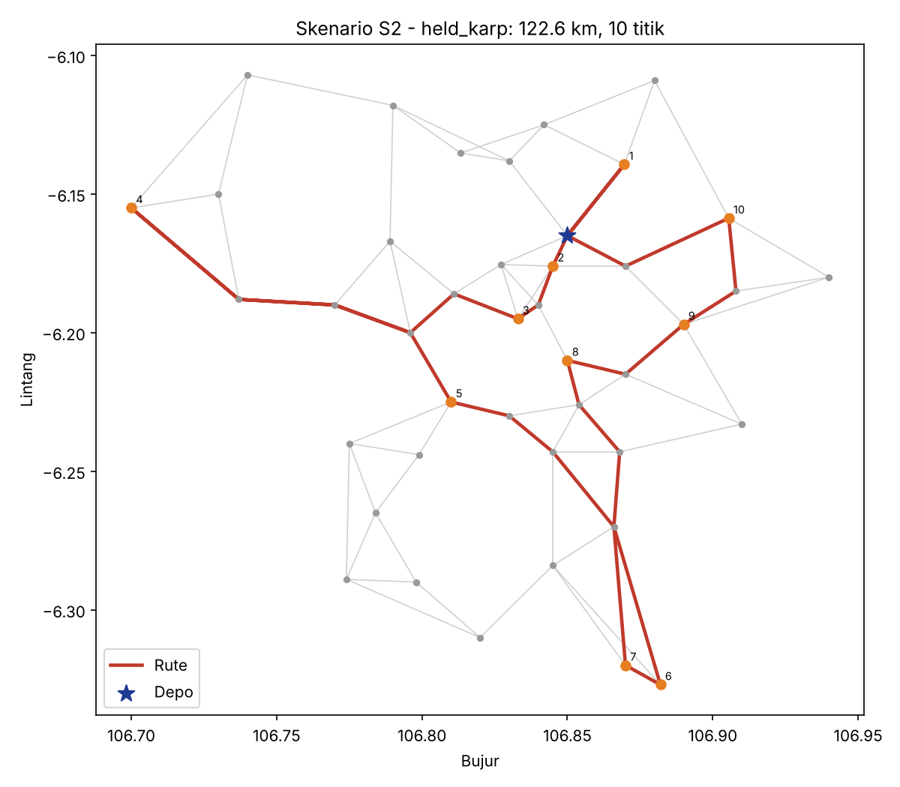

# 1. Masalah

Kurir pengiriman harus mengunjungi *k* titik antar dari satu depo dan kembali, dengan total jarak lintasan jalan sependek mungkin. Urutan masukan yang tidak dioptimalkan menghasilkan jarak jauh lebih panjang. Pengguna sasaran adalah koordinator pengiriman UMKM. Masalah memiliki dua submasalah: jarak terpendek pada graf jalan, dan urutan kunjungan (TSP, NP-hard).

**Kriteria keberhasilan** (D01): rute valid; Held-Karp cocok dengan brute force; rata-rata penghematan ≥ 15% terhadap urutan masukan; selisih rata-rata heuristik ≤ 5% terhadap optimum untuk *k* ≤ 15; waktu ≤ 1 detik; masukan tidak valid ditolak dengan jelas.

# 2. Data

Dataset **sintetis** (`data/`): 42 lokasi di Jakarta (koordinat perkiraan pusat kawasan, informasi geografis publik), 79 ruas jalan sintetis (tiap lokasi dihubungkan ke 3 tetangga terdekat, jarak garis lurus × faktor kelokan acak 1,2–1,6, seed 42, graf dipastikan terhubung), dan 5 skenario pengantaran S1–S5 (6, 10, 13, 25, 41 titik). Tidak ada data pribadi atau kredensial. Hanya 7–19% pasangan lokasi yang punya ruas langsung, sehingga jarak terpendek harus dihitung.

# 3. Desain

{ width=60% }

1. Validasi masukan (duplikat dan depo dibuang, id tidak dikenal ditolak).
2. **Dijkstra** dari tiap titik membangun matriks jarak terpendek *d* dan jalur jalan.
3. Titik tak terjangkau ditolak.
4. Bila *k* ≤ 15: **Held-Karp** (optimal). Bila tidak: **Nearest Neighbor + 2-opt** (heuristik).
5. Rekonstruksi jalur jalan lengkap dan total jarak.

Alasan pemilihan algoritma ada di D02, pseudocode di D03.

# 4. Implementasi

Python 3.13, seluruh algoritma **ditulis sendiri**; pustaka standar saja (`heapq`, `itertools`, `csv`, `argparse`, `time`). `matplotlib` hanya untuk gambar, `pytest` untuk pengujian.

| Modul | Isi |
|---|---|
| `rute/graph.py` | Graf adjacency list, haversine, pemuat CSV |
| `rute/dijkstra.py` | Dijkstra dengan heap dan penghapusan entri usang, rekonstruksi jalur |
| `rute/tsp.py` | Held-Karp, Nearest Neighbor, 2-opt, brute force (pembanding), validasi, `solve()` |
| `rute/cli.py`, `rute/viz.py` | Antarmuka baris perintah dan peta rute |
| `scripts/` | Generator data, trace, eksperimen, diagram alur |

# 5. Hasil pengujian

**Fungsional.** 23 fungsi tes (41 kasus) lulus: normal, batas (0, 1, 2, 41 titik), dan tidak valid. Dijkstra cocok dengan Floyd-Warshall, Held-Karp cocok dengan brute force (D08).

**Kualitas dan kecepatan** (85 instans acak, *k* = 5…15, acuan = optimum Held-Karp):

| Metode | Selisih rata-rata dari optimum | Maks | Optimal ditemukan |
|---|---|---|---|
| Nearest Neighbor | 12,61% | 35,18% | – |
| NN + 2-opt | 1,03% | 13,47% | 63/85 (74%) |
| Held-Karp | 0% | 0% | 85/85 |

Rata-rata Held-Karp 37,1% lebih pendek dari urutan masukan.

{ width=70% }

{ width=70% }

**Skenario (km):**

| Skenario | *k* | Urutan input | NN+2-opt | Held-Karp |
|---|---|---|---|---|
| S1 | 6 | 87,29 | 72,82 | 72,82 |
| S2 | 10 | 159,61 | 127,25 | 122,61 |
| S3 | 13 | 160,32 | 123,23 | 118,90 |
| S4 | 25 | 276,74 | 155,74 | – |
| S5 | 41 | 369,64 | 193,18 | – |

{ width=65% }

# 6. Analisis

**Kompleksitas.** Dijkstra O((V+E) log V) per sumber; Held-Karp O(*k*² 2ᵏ) waktu, O(*k* 2ᵏ) ruang (terukur ×2,3 per tambahan satu titik: 381 ms pada *k* = 15, 891 ms pada *k* = 16); NN O(*k*²); 2-opt O(*k*²) per pass (84 ms untuk 400 titik). Trace dan bukti kebenaran ada di D06.

**Komparatif.** Dijkstra dan TSP solver saling melengkapi (matriks jarak adalah masukan TSP). Pada submasalah TSP, 2-opt memangkas selisih NN dari 12,6% menjadi 1,0% dengan tambahan waktu di bawah 0,1 ms pada *k* ≤ 15, tetapi tidak menjamin optimum; Held-Karp menjamin optimum dengan waktu eksponensial (D07).

**Debugging.** Empat bug nyata ditemukan lewat edge-case test pada draft awal: daftar kosong (crash), duplikat/depo di daftar (rute ganda), id tidak dikenal (`KeyError` mentah), dan titik tak terjangkau (hasil salah **diam-diam** berbiaya `inf`). Semuanya diperbaiki dan diuji ulang (D08 §3).

# 7. Keterbatasan

- Data sintetis; jarak bukan jarak jalan nyata. Hasil numerik tidak bisa diklaim berlaku pada jalanan Jakarta.
- Satu kendaraan, tanpa kapasitas, jendela waktu, lalu lintas, atau jalan satu arah (jarak dianggap simetris).
- Held-Karp tidak layak untuk *k* > ±20 di Python murni (memori eksponensial); batas otomatis diset 15.
- NN+2-opt tidak menjamin optimum; pada 22 dari 85 instans hasilnya di atas optimum.
- Instans *k* = 14 dan 15 hanya 3 dan 2 buah, sehingga selisih rata-rata di sana hanya indikasi.
- Waktu diukur pada satu mesin cloud, angka absolut akan berbeda di mesin lain.

# 8. Kesimpulan

Gabungan Dijkstra (jarak terpendek), Held-Karp (optimal, *k* ≤ 15), dan NN + 2-opt (cepat, *k* besar) memenuhi seluruh kriteria keberhasilan pada data sintetis: rute selalu valid, rata-rata 37,1% lebih pendek dari urutan masukan, heuristik rata-rata hanya 1,03% di atas optimum, dan semua waktu di bawah satu detik. Pengembangan lanjut: data OpenStreetMap, kapasitas dan jendela waktu (VRP), serta heuristik Or-opt/Lin-Kernighan.

# 9. Petunjuk reproduksi

```bash
git clone https://github.com/[USERNAME]/rute-kurir-jakarta.git
cd rute-kurir-jakarta
python -m venv .venv && source .venv/bin/activate      # Windows: .venv\Scripts\activate
pip install -r requirements.txt
python scripts/generate_data.py          # data/*.csv (deterministik)
python -m pytest -v                      # 41 tes
python -m rute.cli --scenario S2 --method auto --plot outputs/figures/rute_S2.png
python scripts/make_traces.py            # outputs/trace/
python scripts/run_experiments.py        # outputs/experiment_*.csv, gambar (~10 detik)
```

# Referensi

[1] E. W. Dijkstra, "A note on two problems in connexion with graphs," *Numerische Mathematik*, vol. 1, pp. 269–271, 1959.
[2] M. Held and R. M. Karp, "A dynamic programming approach to sequencing problems," *J. SIAM*, vol. 10, no. 1, pp. 196–210, 1962.
[3] G. A. Croes, "A method for solving traveling-salesman problems," *Operations Research*, vol. 6, no. 6, pp. 791–812, 1958.
[4] D. J. Rosenkrantz, R. E. Stearns, and P. M. Lewis, "An analysis of several heuristics for the traveling salesman problem," *SIAM J. Computing*, vol. 6, no. 3, pp. 563–581, 1977.
[5] T. H. Cormen, C. E. Leiserson, R. L. Rivest, and C. Stein, *Introduction to Algorithms*, 4th ed. MIT Press, 2022.
